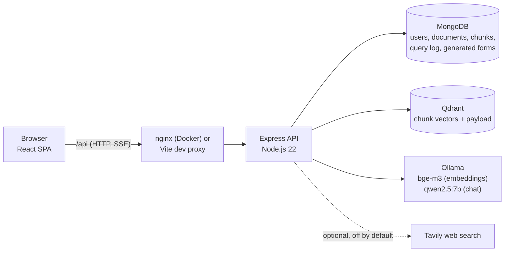
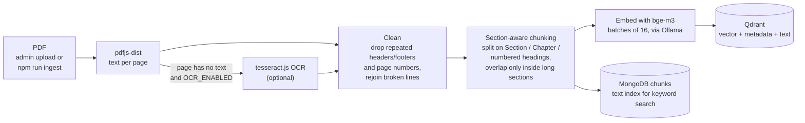
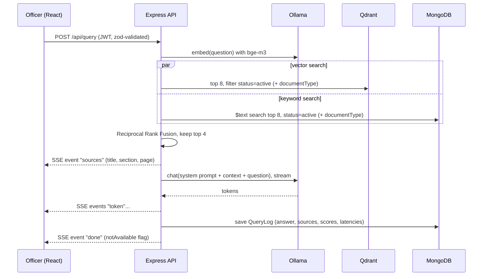
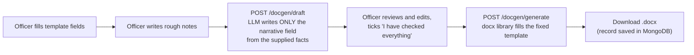
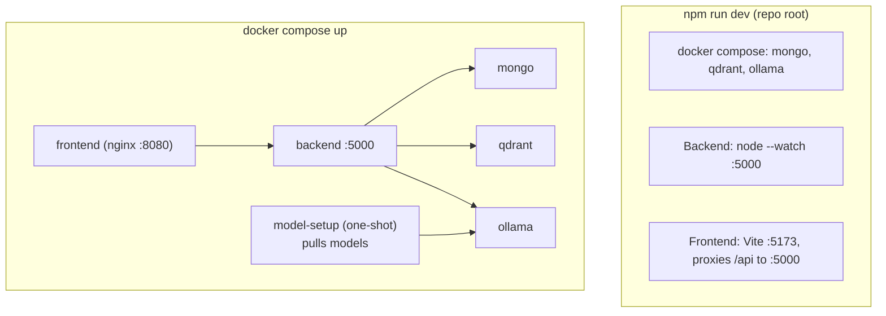

# Tapas Kiran (तपास किरण)

An offline question-answering assistant for police officers. An officer asks a question in Marathi, Hindi or English; the app searches the station's own library of laws, SOPs and guidelines and answers **only from those documents**, with the document title, section and page cited under every answer. It can also pre-fill standard forms and let the officer review a short AI-drafted narrative before downloading a Word file.

**The problem:** procedures and legal sections are spread across many long PDFs, and a general chatbot can invent sections that do not exist. Tapas Kiran restricts the model to retrieved text, shows where each statement came from, and says so when the documents do not contain the answer.

**Offline by design:** every component (database, vector store, embedding model, chat model, web server) runs on the local machine. There are no cloud APIs, no cloud databases and no telemetry. The only optional outbound feature is web search, which is off by default (see [Optional web search](#optional-web-search)).

## Contents

1. [Versions](#versions)
2. [Features](#features)
3. [Architecture](#architecture)
4. [Tech stack](#tech-stack)
5. [Project structure](#project-structure)
6. [How it works in detail](#how-it-works-in-detail)
7. [Data model](#data-model)
8. [API reference](#api-reference)
9. [Security model](#security-model)
10. [Configuration (environment variables)](#configuration-environment-variables)
11. [Setup and running](#setup-and-running)
12. [Ingesting documents](#ingesting-documents)
13. [Evaluation](#evaluation)
14. [Tests](#tests)
15. [Docker services](#docker-services)
16. [Hardware notes](#hardware-notes)
17. [Troubleshooting](#troubleshooting)
18. [Known limitations and future work](#known-limitations-and-future-work)
19. [Differences from v1](#differences-from-v1)

## Versions

- **v1** is the version deployed with Maharashtra Police. *(TODO, owner to write: describe v1 accurately in your own words: what it does, where and how it is deployed, and who uses it.)*
- **v2** (this code) is a rebuild with section-aware chunking, hybrid (vector + keyword) search, multilingual embeddings, streamed answers, an evaluation script and Docker Compose.

This README makes no claims about deployment size, accuracy or number of users. Run `npm run eval` on your own questions to measure retrieval on your own documents.

## Features

- **Cited answers** from the local document library, with title, section and page; the model is told to answer "This information is not available in the provided documents." when the context does not contain the answer.
- **Multilingual**: Marathi, Hindi and English questions and documents (bge-m3 embeddings).
- **Hybrid search**: meaning (vector) plus exact tokens such as section numbers (keyword), merged with Reciprocal Rank Fusion.
- **Streaming** answers (Server-Sent Events), with a Stop button, and follow-up questions that remember the last two turns of a conversation.
- **Document management** (admins): upload PDFs, bulk-ingest from a folder, replace by re-uploading the same title, mark documents outdated without deleting them, delete.
- **Form drafting**: IIF-1 to IIF-5 and Spot Panchnama templates; officer fills the fields, the LLM drafts only the narrative text, the officer reviews, then downloads a `.docx`.
- **Query history** per user, per station or global depending on role; every query is logged with sources, retrieval scores and timings.
- **Roles**: officer, station_admin, super_admin, enforced in the backend; officers need admin approval after signing up.
- **Admin stats**: questions per day, average latency, most common unanswerable questions (hints at missing documents).
- **Graceful AI failures**: Ollama down, slow or missing a model produces a clear message in the UI and a log entry, not a hang.
- **Evaluation script** and automated tests.

## Architecture

### System overview



### Ingestion pipeline



Re-ingesting a document with the same title first deletes its old chunks from both stores, so there are never duplicates.

### Query pipeline



### Form generation flow



### Development and Docker deployment



## Tech stack

| Layer | Technology (version in repo) | Why this choice |
|---|---|---|
| Frontend framework | React 18 + Vite 7 | Common, simple, fast dev server |
| Styling | Tailwind CSS 3 + `@tailwindcss/typography` | Utility classes, no custom CSS framework; typography plugin styles rendered Markdown |
| Routing / HTTP | React Router 7, Axios | Standard; Axios interceptors attach the JWT and handle expiry |
| Answer rendering | react-markdown + remark-gfm | Models answer in Markdown (numbered steps, tables) |
| Streaming client | `fetch` + `ReadableStream` | `EventSource` cannot POST; SSE over POST needs `fetch` |
| Backend runtime | Node.js 22+ (ESM) | Required by pdfjs-dist; same language as the frontend |
| Web framework | Express 5 | Plain and widely known; Express 5 forwards async errors to the error handler |
| Validation | zod 4 | Every request body/query is parsed before use; env vars too |
| App database | MongoDB 7 + Mongoose 9 | Flexible documents for logs and metadata; built-in text index for keyword search |
| Vector store | Qdrant (Docker) | Local, fast, filters on payload (`status`, `documentType`) during the search |
| Embeddings | `bge-m3` via Ollama (1024 dimensions) | One multilingual model covering Marathi, Hindi and English |
| Chat model | `qwen2.5:7b` via Ollama (configurable, e.g. `llama3.1:8b`) | Runs locally; temperature 0.1 and a large `num_ctx` keep answers on the context |
| PDF parsing | pdfjs-dist 6 | Gives text per page, so citations carry page numbers |
| OCR (optional) | tesseract.js + @napi-rs/canvas | For scanned pages, behind a flag, with local language data only |
| Auth | jsonwebtoken (JWT, 1 h) + bcryptjs | Stateless sessions; bcrypt password hashing (pure JS, no native build) |
| HTTP hardening | helmet, cors, express-rate-limit | Security headers, origin allow-list, brute-force and LLM-overload limits |
| Uploads | multer 2 (memory storage) | PDF only, size-limited, magic-byte checked |
| Word documents | docx 9 | Builds `.docx` from fixed templates in code |
| Logging | pino | Structured JSON logs; Authorization header and passwords redacted |
| Tests | Jest 30 + supertest | Chunking, cleaning, RRF, prompt builder, auth and roles |
| Sample data | pdfkit (dev only) | Generates the fictional demo PDFs |
| Dev orchestration | concurrently (repo root) | One `npm run dev` starts everything |
| Infrastructure | Docker Compose, nginx | One command for the whole stack; nginx serves the SPA and proxies `/api` with buffering off for SSE |
| Optional web search | Tavily REST API | Only when explicitly enabled and ticked per question |

## Project structure

```
.
├── docker-compose.yml        mongo, qdrant, ollama, model-setup, backend, frontend
├── package.json              root scripts: dev, ai, models, install:all, test
├── sample-docs/              3 FICTIONAL PDFs for demos (generated by npm run sample-docs)
├── scripts/                  setup-models.sh / setup-models.ps1 (pull Ollama models)
├── Backend/
│   ├── server.js             entry: connect DB, seed first admin, create Qdrant collection, listen
│   ├── app.js                Express app: helmet, cors, routes, central error handler
│   ├── config/               env.js (zod-validated .env), db.js
│   ├── routes/               auth, users, documents, query (+history), docgen, stats
│   ├── controllers/          one per route group; thin, call services
│   ├── middleware/           auth.js (protect, requireRole), validate.js, errorHandler.js
│   ├── models/               User, Document, Chunk, QueryLog, GeneratedDoc
│   ├── services/
│   │   ├── ingestion/        pdf.js, clean.js, headings.js, chunker.js, index.js
│   │   ├── rag/              retrieve.js, rrf.js, prompt.js, webSearch.js
│   │   ├── llm/ollama.js     embed, chat, chatStream, timeouts, health
│   │   ├── vector/qdrant.js  collection, upsert, search, delete, set status
│   │   └── docgen/           templates.js, draft.js, build.js
│   ├── utils/                logger.js, AppError.js, scope.js (who sees which history)
│   ├── scripts/              ingest.js (CLI), eval.js, makeSamplePdfs.js
│   ├── eval/questions.json   placeholder evaluation questions (you must replace them)
│   ├── tests/                chunker, prompt, auth/role tests
│   ├── Dockerfile, .env.example
│   └── AI/docs/              (git-ignored) local folder for your own real documents
└── Frontend/
    ├── src/
    │   ├── main.jsx, App.jsx, api.js, auth.jsx
    │   ├── components/       Layout, Sources, ui (Spinner, ErrorBox, Async)
    │   └── pages/            Login, Signup, Chat, History, DocGen,
    │                         AdminDocuments, AdminUsers, AdminStats
    ├── Dockerfile, nginx.conf
    └── vite.config.js        dev proxy /api -> localhost:5000
```

## How it works in detail

### PDF parsing and cleaning (`services/ingestion/pdf.js`, `clean.js`)

- pdfjs-dist extracts text page by page and keeps the page number for every line.
- If a page has almost no text and `OCR_ENABLED=true`, the page is rendered to an image and OCR'd (tesseract.js, using local language data only).
- Cleaning removes lines that repeat at the top/bottom of many pages (headers/footers, detected after replacing digits), standalone page numbers, and joins lines that the PDF wrapped in the middle of a sentence (including hyphenated words). Heading lines are never glued to the previous line.

### Section-aware chunking (`headings.js`, `chunker.js`)

- A new section starts at `Section N`, `Sec. N`, `Article`, `Rule`, `Regulation`, `कलम`, `धारा`, `नियम` (always), at `Chapter` / `अध्याय` (always), or at numbered headings such as `103. Title` and `3.2 Title` (only if the section so far has at least 200 characters, so short list items are not split into tiny chunks).
- A section up to 1500 characters stays whole. Longer sections are split on line/sentence boundaries with about 150 characters of overlap, and each continuation chunk starts with the section heading plus "(continued)".
- Every chunk stores: `documentId`, `documentTitle`, `documentType` (SOP / law / guideline), `sectionNumber`, `pageNumber`, `language` (en / devanagari / mixed, detected by script), `version`, `status` (active / outdated).

### Hybrid retrieval (`services/rag/retrieve.js`, `rrf.js`)

- **Vector search** (Qdrant, top 8) finds chunks by meaning, across Marathi, Hindi and English.
- **Keyword search** (MongoDB `$text` index, top 8, language `none` so Marathi tokens and numbers like "103" are not stemmed) finds exact tokens such as section numbers and form names.
- **Reciprocal Rank Fusion** merges the two ranked lists using rank positions only (score = sum of 1/(60 + rank)), because cosine similarity and text scores are on different scales. The top 4 are kept.
- Only `status = active` chunks are searched in both stores; an optional `documentType` filter is applied in both.

### Prompt and answer (`services/rag/prompt.js`, `controllers/queryController.js`)

- The system prompt forbids outside knowledge, requires the exact fallback sentence when the answer is missing, requires citations as `[Document title, Section X, Page N]`, asks for step-by-step answers and for replying in the question's language, and marks web text as unverified.
- The user message contains the labelled context chunks and the question; the last two answered turns of the same conversation are included as chat history.
- If retrieval returns nothing, the fixed fallback sentence is returned without calling the model.
- The answer is streamed as Server-Sent Events (`sources`, `token`, `done`, `error`). If the browser disconnects, generation is aborted.
- Every query is stored with answer, sources, per-chunk vector/keyword/RRF scores, and embedding / retrieval / generation times in milliseconds.

### Model settings

Temperature defaults to 0.1 (stay close to the context) and `num_ctx` to 8192 (room for 4 chunks, the prompt and the answer). Both are environment variables, as are the chat and embedding model names.

### Failure handling (Ollama down or slow)

Every Ollama call has an idle timeout (`OLLAMA_TIMEOUT_MS`, reset on every streamed chunk). Connection failures, missing models, non-200 responses and timeouts become one `OllamaError` with a user-readable message; it is shown in the chat and logged by pino. `GET /api/health` reports whether MongoDB, Ollama and Qdrant are reachable.

### Form generation (`services/docgen`)

Templates are fixed field lists (IIF-1, IIF-2, IIF-3, IIF-4, IIF-5, Spot Panchnama) with Marathi/English labels and one designated narrative field each. The LLM receives only the officer's known fields and rough notes and is instructed not to invent names, dates, places, amounts or sections. The officer must tick a review box before the `.docx` can be downloaded, and each generated form is recorded (who, which template).

## Data model

**MongoDB collections**

| Collection | Main fields |
|---|---|
| `users` | name, email (unique), bcrypt `password` (never returned), phone, district, taluka, policeStation, `stationKey`, `role`, `active`, lastLogin, lastLogout, loginCount |
| `documents` | title (unique), documentType, version, status, language, filename, pageCount, chunkCount, ingestState (processing / ready / failed), ingestError, uploadedBy |
| `chunks` | documentId, documentTitle, documentType, sectionNumber, pageNumber, language, version, status, chunkIndex, text (**text index**) |
| `querylogs` | userId, stationKey, conversationId, question, answer, documentType, sources[], scores[], latencyMs{embedding, retrieval, generation}, notAvailable, usedWeb, error |
| `generateddocs` | userId, stationKey, template, fields, narrative |

**Qdrant collection** (`tapas_kiran_chunks`): cosine distance, 1024 dimensions. Each point's payload repeats the chunk metadata plus `chunkId` and the full `text`. Keyword-indexed payload fields: `documentId`, `status`, `documentType`.

## API reference

All routes are under `/api`. "Auth" means `Authorization: Bearer <JWT>`.

| Method and path | Access | Purpose |
|---|---|---|
| `GET /health` | public | MongoDB / Ollama / Qdrant reachability, whether web search is available |
| `POST /auth/signup` | public, rate-limited | Create an inactive officer account (needs admin approval) |
| `POST /auth/login` | public, rate-limited | Returns JWT and user |
| `GET /auth/me` | auth | Current user |
| `POST /auth/logout` | auth | Records logout time |
| `GET /users` | admin | List users (own station for station_admin, all for super_admin) |
| `PATCH /users/:id` | admin | Approve/disable, reset password, change role (role changes: super_admin only) |
| `GET /documents` | auth | List documents with ingestion state |
| `POST /documents` | admin | Upload a PDF (multipart; ingestion runs in the background, returns 202) |
| `PATCH /documents/:id/status` | admin | Mark `active` or `outdated` |
| `DELETE /documents/:id` | admin | Delete document, chunks and vectors |
| `POST /query` | auth, rate-limited per user | Ask a question; answer streamed as SSE |
| `GET /history?limit&skip` | auth | Query history scoped by role |
| `GET /docgen/templates` | auth | Form templates |
| `POST /docgen/draft` | auth | LLM drafts the narrative field |
| `POST /docgen/generate` | auth | Returns the filled `.docx` |
| `GET /docgen/history` | auth | Generated forms, scoped by role |
| `GET /admin/stats` | admin | Usage, latency, unanswerable questions (last 14 days) |

## Security model

| Control | Implementation |
|---|---|
| Authentication | JWT (default expiry 1 h), verified on every request; the user is re-loaded from MongoDB so a disabled account stops working immediately |
| Passwords | bcrypt hashes, minimum 8 characters, never selected or logged |
| Account creation | Self-signup creates an **inactive** officer; a station_admin of that station or a super_admin approves it |
| Roles | `officer`, `station_admin`, `super_admin`, enforced by backend middleware; hiding buttons in the UI is not relied on |
| Station isolation | History and user lists are filtered server-side: officers see their own, station_admins their station, super_admins all (`utils/scope.js`) |
| Admin limits | A station_admin can only manage officers in their own station; only a super_admin can change roles; nobody can change their own role or status |
| Input validation | zod schemas on every body and query; env vars validated at startup |
| Uploads | PDF mimetype + `%PDF-` magic bytes, size limit, single file, memory storage |
| Rate limits | Login/signup per IP; `/query` per user (default 10/min) because the local LLM is slow |
| Headers and CORS | helmet defaults; CORS limited to `CORS_ORIGINS` |
| Logging | pino JSON; Authorization header and password redacted; errors hide internals behind a generic 500 |
| Data locality | No external calls unless optional web search is enabled and ticked for a question |

## Configuration (environment variables)

Copy `Backend/.env.example` to `Backend/.env`. Values are validated at startup; a bad value stops the server with a clear message. Inside Docker Compose, `MONGO_URI`, `OLLAMA_URL`, `QDRANT_URL` and `CORS_ORIGINS` are set by `docker-compose.yml`.

| Variable | Default | Meaning |
|---|---|---|
| `NODE_ENV` | development | development / production / test |
| `PORT` | 5000 | API port |
| `LOG_LEVEL` | info | pino level |
| `CORS_ORIGINS` | http://localhost:5173 | Comma-separated allowed browser origins |
| `MONGO_URI` | mongodb://localhost:27017/tapas-kiran | `.env.example` uses `mongodb://127.0.0.1:27018/tapas-kiran` (the Compose MongoDB) |
| `JWT_SECRET` | **required**, min 16 chars | Signing key for tokens |
| `JWT_EXPIRES_IN` | 1h | Token lifetime |
| `SEED_ADMIN_EMAIL`, `SEED_ADMIN_PASSWORD` | unset | Creates the first super_admin if none exists |
| `OLLAMA_URL` | http://localhost:11434 | Ollama endpoint |
| `CHAT_MODEL` | qwen2.5:7b | Chat model name (any Ollama chat model) |
| `EMBED_MODEL` | bge-m3 | Embedding model name |
| `EMBED_DIM` | 1024 | Embedding size; must match the model (changing models means re-ingesting everything) |
| `TEMPERATURE` | 0.1 | Sampling temperature |
| `NUM_CTX` | 8192 | Context window in tokens |
| `OLLAMA_TIMEOUT_MS` | 120000 | Abort if Ollama is silent this long |
| `QDRANT_URL` | http://localhost:6333 | Qdrant endpoint |
| `QDRANT_COLLECTION` | tapas_kiran_chunks | Collection name |
| `MAX_UPLOAD_MB` | 50 | Upload size limit |
| `OCR_ENABLED` | false | OCR for pages without text |
| `OCR_LANG_PATH` | unset | Folder with Tesseract `*.traineddata` files (so OCR never downloads) |
| `QUERY_RATE_LIMIT_PER_MIN` | 10 | Questions per user per minute |
| `WEB_SEARCH_ENABLED`, `TAVILY_API_KEY` | false, unset | Optional web search |

Docker Compose also reads `INGEST_DIR` (folder mounted at `/data/docs` in the backend container, default `./sample-docs`).

## Setup and running

### Requirements

- Docker with Compose (Docker Desktop on Windows/macOS).
- Node.js 22.13+ for development without containers.
- Disk for the models (about 6 GB for the defaults) and enough RAM (see [Hardware notes](#hardware-notes)).
- Internet **once**, to download the Ollama models; afterwards everything is offline.

### Option A: everything in Docker

```bash
cp Backend/.env.example Backend/.env      # edit JWT_SECRET and SEED_ADMIN_PASSWORD
docker compose up --build
```

This starts MongoDB, Qdrant, Ollama, a one-shot `model-setup` service that pulls `bge-m3` and the chat model, the backend (port 5000) and the frontend (nginx, port 8080). Open <http://localhost:8080>.

### Option B: development with one command

```bash
cp Backend/.env.example Backend/.env      # once
npm run install:all                       # once: root, Backend and Frontend dependencies
npm run models                            # once: pull bge-m3 and qwen2.5:7b into the Ollama container
npm run dev                               # MongoDB + Qdrant + Ollama (Docker), backend, frontend
```

Open <http://localhost:5173>. `Ctrl+C` stops the backend and frontend; `npm run ai:stop` stops the Docker services. Docker Desktop must already be running.

| Root script | Does |
|---|---|
| `npm run dev` | `npm run ai`, then backend (`node --watch`) and frontend (Vite) together |
| `npm run ai` | `docker compose up -d --wait mongo qdrant ollama` |
| `npm run ai:stop` | Stops those three containers |
| `npm run models` | Pulls `bge-m3` and `qwen2.5:7b` |
| `npm run install:all` | `npm install` in root, Backend and Frontend |
| `npm test` | Backend tests |

### First login

Log in with `SEED_ADMIN_EMAIL` / `SEED_ADMIN_PASSWORD` from `Backend/.env` (the seed runs only when the database has no super_admin yet). Change that password. New officers use **Request an account**; an admin approves them under **Users**.

### Roles

| Role | Can do |
|---|---|
| `officer` | Ask questions, see own history, draft forms |
| `station_admin` | Also: upload / delete / mark documents outdated (documents are shared by all stations), approve and manage officers of their own station, see their station's history and stats |
| `super_admin` | Everything across all stations, including changing roles |

## Ingesting documents

- **From the UI:** log in as an admin, open **Documents**, upload a PDF, choose its type (law / SOP / guideline) and version. Uploading a title that already exists replaces the old chunks. Processing happens in the background and the table shows the state.
- **In bulk (CLI):**
  ```bash
  # Docker
  docker compose exec backend npm run ingest -- /data/docs [--type SOP|law|guideline]
  # Development
  cd Backend && npm run ingest -- ../sample-docs
  ```
  Without `--type`, the type is guessed from the file path. Titles come from file names.
- **Demo data:** `sample-docs/` holds three **fictional** PDFs (a made-up law, procedure and guideline), regenerated with `cd Backend && npm run sample-docs`. They are not real law or real police procedure. **No real police documents, credentials or personal data are included in this repository.**
- **Scanned PDFs:** set `OCR_ENABLED=true`, run `npm install tesseract.js @napi-rs/canvas` in `Backend/`, and provide Tesseract language files locally via `OCR_LANG_PATH`. OCR is implemented but has not been exercised in testing.

## Evaluation

```bash
cd Backend
npm run eval                 # retrieval hit rate + "not available" behaviour (needs the chat model)
npm run eval -- --skip-llm   # retrieval only (fast)
```

- **Retrieval hit rate:** for in-scope questions, was the expected document (and section, if given) among the top 4 chunks?
- **Out-of-scope behaviour:** for questions the documents cannot answer, does the model reply with the "not available" sentence?

`Backend/eval/questions.json` ships with **5 placeholder entries about the fictional sample documents**. Replace them with real questions and the expected document/section from your own library; the script reports only what it measures on that file, and small question sets give noisy percentages.

## Tests

```bash
cd Backend && npm test
```

Jest + supertest cover section-aware chunking, text cleaning, Reciprocal Rank Fusion, the prompt builder, authentication (missing / invalid / expired tokens, deactivated accounts) and role checks. The auth tests stub the single database lookup, so no database is needed.

## Docker services

| Service | Image | Port | Notes |
|---|---|---|---|
| `mongo` | mongo:7 | 127.0.0.1:27018 | Published on 27018 (localhost only) to avoid clashing with a host MongoDB |
| `qdrant` | qdrant/qdrant | 6333 | Vector store |
| `ollama` | ollama/ollama | 11434 | Models stored in a volume; GPU settings are commented in the compose file |
| `model-setup` | ollama/ollama | none | One-shot: pulls `EMBED_MODEL` and `CHAT_MODEL`, then exits |
| `backend` | built from `Backend/` | 5000 | Reads secrets from `Backend/.env` |
| `frontend` | built from `Frontend/` (nginx) | 8080 | Serves the SPA, proxies `/api`, buffering off for streaming |

Named volumes: `mongo-data`, `qdrant-data`, `ollama-data`.

## Hardware notes

- CPU-only inference works but is slow; the first question after start-up also pays model load time. A GPU makes a large difference.
- `qwen2.5:7b` needs roughly 5-6 GB of memory for the model alone, plus `bge-m3` and the other containers. If Docker Desktop has only about 4 GB, the model process is killed and the app reports an AI error. Raise Docker's memory limit, or set `CHAT_MODEL` to a smaller model such as `qwen2.5:3b` or `qwen2.5:1.5b` (lower answer quality).
- Marathi/Hindi answer quality depends on the chat model; check it with your own questions in `eval/`.

## Troubleshooting

| Symptom | Cause and fix |
|---|---|
| Backend exits with "Invalid environment configuration" | `Backend/.env` is missing or still an old file; copy `Backend/.env.example` and set `JWT_SECRET` (16+ characters) |
| Vite "http proxy error ECONNREFUSED" | The backend is not running (see the error above) |
| "The AI model took too long to respond" / Ollama error 500 | Model too large for available memory, or still loading; use a smaller `CHAT_MODEL` or give Docker more RAM, then retry |
| "Model not found in Ollama" | Run `npm run models` (or `scripts/setup-models.sh` / `.ps1`) |
| Port 27017 already in use | Expected: Compose publishes MongoDB on 27018 instead |
| Cannot log in as the seeded admin | The seed only runs when no super_admin exists; the password in `.env` does not change an existing account |
| Upload shows "failed: No text found" | Scanned PDF; enable OCR (see above) |
| `ollama pull` fails with a DNS error | Transient Docker DNS issue; retry |

## Optional web search

Off by default. If `WEB_SEARCH_ENABLED=true` and `TAVILY_API_KEY` is set, officers see a checkbox "Also search the web (question leaves this machine)". When ticked, **that question is sent to Tavily over the internet**, and the results are labelled `WEB (unverified)` in the prompt. With no internet connection the call fails quietly and the answer uses documents only. Leave it disabled for a fully offline deployment.

## Known limitations and future work

- A 7B model on CPU is slow and weaker than large hosted models. A bigger model on a GPU is the obvious upgrade.
- No reranker yet: the top 4 come straight from rank fusion. A local cross-encoder reranker is the next retrieval improvement.
- Tables and multi-column layouts in PDFs are read as plain text and may lose structure.
- Section detection relies on heading patterns; unusual layouts fall back to size-based splitting.
- Changing the embedding model requires re-ingesting all documents.
- Conversation memory is limited to the last two answered turns.
- Form templates are a condensed port of the v1 IIF forms (checkbox groups became text fields); compare them with the official printed forms before real use. The AI-drafted narrative must always be reviewed by the officer.
- Future work: agent-based multi-step flows with LangGraph, a failover server, a re-indexing job, a reranker, GPU deployment.

## Differences from v1

Some v1 behaviours were changed because they need the internet or a cloud service, which conflicts with the offline requirement:

- OpenAI models and embeddings, LangChain/LangGraph and the in-memory vector store were replaced by Ollama, Qdrant and a plain-code pipeline.
- Browser voice input and online Marathi transliteration were removed (both call external services).
- E-mail OTP codes were removed (they need SMTP); accounts are approved by admins instead.
- The shared admin password was replaced by real role-based accounts.
- Web search (Tavily) was kept as an opt-in feature.
- v1's hard-coded statute cross-reference sheet and 680-line system prompt were not carried over; that knowledge should come from ingested documents.
