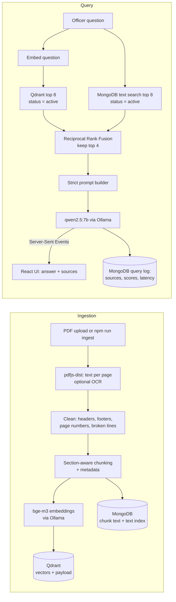

# Tapas Kiran (तपास किरण)

An offline question-answering assistant for police officers. An officer asks a question in Marathi, Hindi or English; the app searches the station's own library of laws, SOPs and guidelines and answers **only from those documents**, with the document title, section and page cited under every answer. It can also pre-fill standard forms and let the officer review a short AI-drafted narrative before downloading a Word file.

The problem it addresses: procedures and legal sections are spread across many long PDFs, and a general chatbot can invent sections that do not exist. Tapas Kiran restricts the model to retrieved text, shows where each statement came from, and says so when the documents do not contain the answer. Everything runs on the local machine: no cloud API, no cloud database, no telemetry.

## Versions

- **v1** is the version deployed with Maharashtra Police. *(TODO, owner to write: describe v1 accurately in your own words: what it does, where and how it is deployed, and who uses it.)*
- **v2** (this code) is a rebuild with section-aware chunking, hybrid (vector + keyword) search, multilingual embeddings, streamed answers, an evaluation script and Docker Compose.

This README makes no claims about deployment size, accuracy or users. Run `npm run eval` on your own questions to measure retrieval on your documents.

## Architecture



## Tech stack

| Part | Choice | Why |
|---|---|---|
| Frontend | React + Vite + Tailwind, React Router, Axios, react-markdown | Plain, common tools; Markdown renders the step-by-step answers |
| Backend | Node.js + Express 5, Mongoose, zod | Small and readable; zod validates every request body |
| Security | JWT (1 h), bcrypt, role middleware, helmet, cors, express-rate-limit | Roles are enforced on the server; rate limit protects the slow local LLM |
| App database | MongoDB | Users, documents, chunks, query log, generated forms |
| Vector store | Qdrant (local Docker) | Filters on payload (`status`, `documentType`) during search, so outdated documents never match |
| Embeddings | `bge-m3` via Ollama | One multilingual model covering Marathi, Hindi and English |
| Chat model | `qwen2.5:7b` via Ollama (configurable) | Runs locally; temperature 0.1 and a large `num_ctx` keep it on the context |
| PDF parsing | pdfjs-dist | Gives text per page, so citations have page numbers |
| OCR (optional) | tesseract.js | For scanned pages, behind a flag |
| Forms | `docx` | Fixed templates filled by code; the LLM drafts only the one narrative field |
| Logging | pino | Structured JSON logs, with credentials redacted |
| Infra | Docker Compose | One command starts frontend, backend, MongoDB, Qdrant and Ollama |

## Setup

Requirements: Docker with Compose. About 8 GB of free disk for the models; a GPU is optional (see the comment in `docker-compose.yml`). The first run needs internet once, to download the models.

```bash
cp Backend/.env.example Backend/.env     # then edit JWT_SECRET and the seed admin password
docker compose up --build
```

`docker compose up` also runs a one-shot `model-setup` service that pulls `bge-m3` and the chat model. To pull them yourself (or on a host-installed Ollama) use `scripts/setup-models.sh` or `scripts/setup-models.ps1`.

Open <http://localhost:8080> and log in with `SEED_ADMIN_EMAIL` / `SEED_ADMIN_PASSWORD` from `Backend/.env`. Change that password. New officers use "Request an account" and an admin approves them under **Users**.

### Roles

| Role | Can do |
|---|---|
| `officer` | Ask questions, see own history, draft forms |
| `station_admin` | Also: upload/delete/mark documents outdated, approve and manage officers of their own station, see their station's history and stats |
| `super_admin` | Everything, across all stations, including changing roles |

### Development: one command

```bash
cp Backend/.env.example Backend/.env   # once; MONGO_URI there already points at the Docker MongoDB (port 27018)
npm run install:all                    # once: installs root, Backend and Frontend dependencies
npm run models                         # once: pulls bge-m3 and qwen2.5:7b into the Ollama container
npm run dev                            # starts MongoDB + Qdrant + Ollama (Docker), the backend and the frontend
```

Then open <http://localhost:5173>. `Ctrl+C` stops the backend and frontend; `npm run ai:stop` stops the Docker services. Docker Desktop must already be running.

## Environment variables

Every variable is documented in [`Backend/.env.example`](Backend/.env.example) and validated at startup (a bad value stops the server with a clear message). The important ones: `JWT_SECRET`, `SEED_ADMIN_EMAIL`/`SEED_ADMIN_PASSWORD`, `CHAT_MODEL`, `EMBED_MODEL`, `NUM_CTX`, `OLLAMA_URL`, `QDRANT_URL`, `OLLAMA_TIMEOUT_MS`, `QUERY_RATE_LIMIT_PER_MIN`, `OCR_ENABLED`, `WEB_SEARCH_ENABLED`.

## Ingesting documents

- **From the UI:** log in as an admin, open **Documents**, upload a PDF, choose its type (law / SOP / guideline). Uploading a title that already exists replaces the old chunks. Use **Mark outdated** to take a document out of search without deleting it.
- **In bulk:** put PDFs in a folder and run
  ```bash
  docker compose exec backend npm run ingest -- /data/docs [--type SOP|law|guideline]
  ```
  The folder mounted at `/data/docs` is `./sample-docs` by default; set `INGEST_DIR` to use another. Without `--type`, the type is guessed from the path.
- **Demo data:** `sample-docs/` holds three **fictional** PDFs (made-up law, procedure and guideline) generated by `npm run sample-docs`. They are not real law or real police procedure. No real police documents are included in this repository.

Scanned PDFs need `OCR_ENABLED=true`, `npm install tesseract.js @napi-rs/canvas` in `Backend/`, and Tesseract language files stored locally (`OCR_LANG_PATH`) so OCR never downloads anything.

## Evaluation

```bash
cd Backend
npm run eval                 # retrieval hit rate + "not available" behaviour
npm run eval -- --skip-llm   # retrieval only (fast)
```

`Backend/eval/questions.json` ships with **5 placeholder entries about the fictional sample documents**. Replace them with real questions and the expected document/section from your own library; the script reports only what it measures on that file.

## Tests

```bash
cd Backend && npm test
```

Covers section-aware chunking, text cleaning, Reciprocal Rank Fusion, the prompt builder, authentication and role checks.

## Optional web search

Off by default. If `WEB_SEARCH_ENABLED=true` and `TAVILY_API_KEY` is set, officers see a checkbox "Also search the web"; when ticked, **that question is sent to Tavily over the internet** and the results are labelled unverified in the answer. With no internet, the app silently falls back to documents only.

## Known limitations and future work

- A 7B model on CPU is slow (answers can take a minute or more) and weaker than large hosted models. A bigger model on a GPU is the obvious upgrade.
- No reranker yet: the top 4 come straight from rank fusion. A local cross-encoder reranker would be the next retrieval improvement.
- Tables and multi-column layouts in PDFs are read as plain text and may lose structure.
- Section detection uses heading patterns (`Section 12`, `103.`, `3.2`, chapters); unusual layouts fall back to size-based splitting.
- Marathi/Hindi quality depends on the chat model; verify with your own questions in `eval/`.
- Form templates are a condensed port of the v1 IIF forms; compare with the official printed forms before real use. The AI narrative must always be reviewed by the officer.
- Future: agent-based multi-step flows with LangGraph, a failover server, a re-indexing job when the embedding model changes.

### Differences from v1

Some v1 behaviours were changed because they need the internet or a cloud service, which conflicts with the offline requirement: OpenAI models and embeddings (now Ollama), browser voice input and online Marathi transliteration (both call external services), e-mail OTP codes (needs SMTP), the shared admin password (now real role-based accounts). Web search is kept as an opt-in feature. v1's hard-coded statute cross-reference sheet and system prompt were not carried over; that knowledge should come from ingested documents instead.
